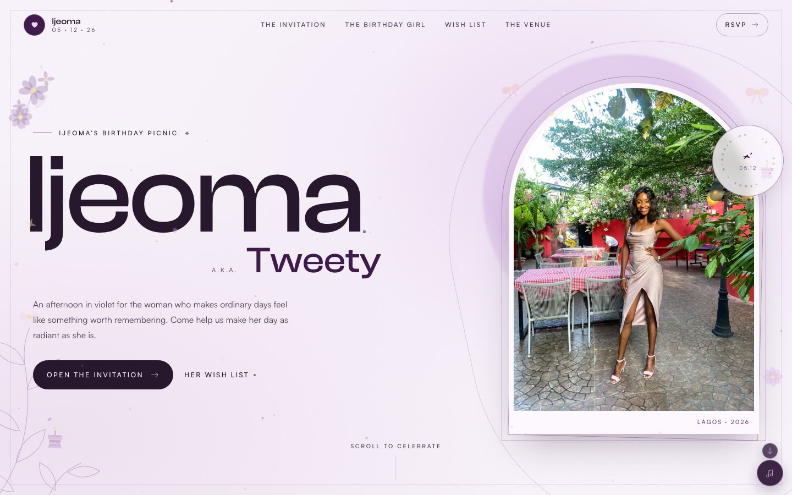
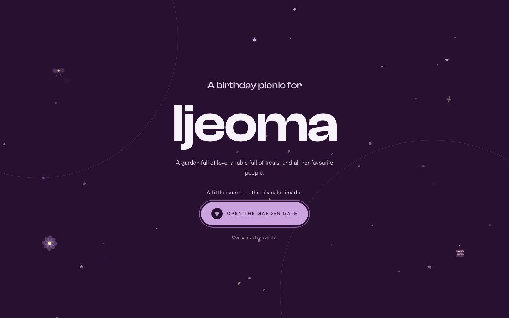
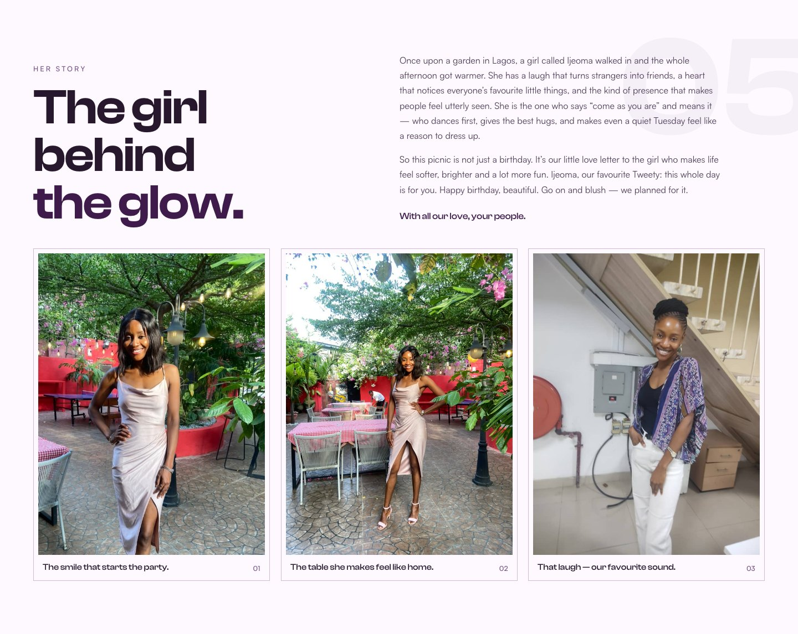
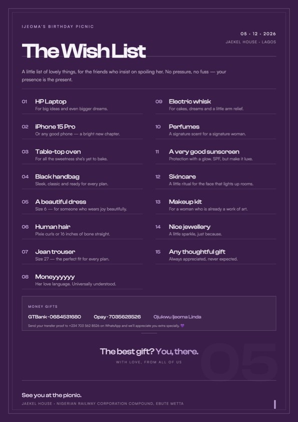

# Ijeoma’s Birthday Picnic

A shorter, bolder one-page birthday invitation for **Ijeoma (Tweety)** — Saturday, 5 December 2026 at **Jaekel House, Nigerian Railway Corporation Compound, Ebute Metta, Lagos**.

Directions: **+234 703 562 8526** or **+234 705 718 8970**.

**Live site:** https://marquis-code.github.io/ijeoma-birthday-picnic/









## Stack

- **React 19**
- **Vite 8**
- **Tailwind CSS 4**
- **Satoshi** for body and UI text, **Clash Display** for headings — the fonts used in `cfml-mobile`
- `html2canvas` + `jsPDF` for the downloadable wish-list PDF
- Satoshi and Clash Display are the fonts used in `cfml-mobile` (Fontshare)
- GitHub Actions → GitHub Pages

## The experience

- **Opening gate:** the site opens on a full-screen “Ijeoma” screen. One tap reveals the celebration and starts its background soundtrack. Browsers block unmuted autoplay, so this gate is the reliable way to begin the audio as the site opens.
- **Hero:** Clash Display name treatment, portrait, the date, time and place.
- **Invitation:** compact card with dress code, what to bring and a live countdown.
- **Her story:** three portrait cards in a short gallery.
- **Wishlist:** 15 items in a compact two-column list, tap-to-save checkmarks, a **Download wishlist PDF** button and a money-gift card.
- **Venue:** full official address, two directions phone numbers and a direct Google Maps link.
- **RSVP:** short form, confirmation, native share and `.ics` calendar download.
- **Extras:** floating music control, confetti, soft dust, scroll reveals, reduced-motion support.

The main page is intentionally much shorter than the previous version: roughly **6,400px on desktop** and **8,600px on mobile**, with repeated copy removed.

## Money gifts

The wishlist section includes the account details supplied for money gifts:

- **GTBank:** 0684531680
- **Opay:** 7035628526
- **Account name:** Ojukwu Ijeoma Linda

After sending, guests are invited to WhatsApp their transfer proof to **+234 703 562 8526** so the family can appreciate them extra specially. The same details appear on the downloadable PDF.

## Music note

The background sequence begins when the opening gate is clicked and advances to a second track after the first. No track titles are shown on the site.

The opening soundtrack is embedded from YouTube and starts with the one-tap opening gate. No audio file is bundled in the repository.

Modern browsers refuse to start unmuted audio without a user gesture. The **opening gate** is therefore the one click required to start the background soundtrack. If your network blocks YouTube, the site still works.

## Wishlist PDF

The purple **Download wishlist PDF** button creates a clean A4 PDF in the browser. It includes the title **Ijeoma’s Birthday Wishlist**, all 15 items, the money-gift details and the transfer-proof note, and downloads as:

`Ijeoma-Birthday-Wishlist.pdf`

The web version’s checkmarks are a personal, device-local checklist (`localStorage`), not a shared registry. The PDF is the version to send to friends or family.

## Run locally

```bash
npm install
npm run dev
```

Production preview:

```bash
npm run build
npm run preview
```

## Project structure

```text
src/
  App.jsx                  Page composition
  context/MusicContext.jsx Opening soundtrack / YouTube player context
  components/
    OpeningGate.jsx        One-tap music entry
    Hero.jsx
    Invitation.jsx         Compact invitation + inline countdown
    Story.jsx              Short photo gallery
    Wishlist.jsx           Compact list + PDF export
    WishlistPdf.jsx        Hidden A4 design captured to PDF
    MoneyGifts.jsx         Account details, copy buttons and WhatsApp proof link
    Venue.jsx              Full address and directions
    Rsvp.jsx
    Footer.jsx
    Nav.jsx
      Effects.jsx
    Icon.jsx
  data/wishes.js           The 15 wish-list entries
  lib/                     Calendar, confetti, storage and asset helpers
  index.css                Tailwind import, fonts, @theme tokens and custom art
public/assets/images/      The supplied photographs
.github/workflows/deploy.yml
```

## Personalise it

- **Copy and layout:** edit the relevant component in `src/components`.
- **Wish list:** edit `src/data/wishes.js`; the web count and PDF update automatically.
- **Colours:** edit the `@theme` tokens at the top of `src/index.css`.
- **Fonts:** Satoshi and Clash Display are self-hosted in `src/assets/fonts/`.
- **Photos:** replace the files in `public/assets/images/` while keeping the filenames.
- **Full address:** `src/components/Venue.jsx` and `src/lib/calendar.js`.
- **RSVP delivery:** replies are saved locally by default. To deliver them automatically, add a form endpoint or WhatsApp number before the Vite entry script in `index.html`:

```html
<script>
  window.IJEOMA_CONFIG = {
    rsvpEndpoint: "https://formspree.io/f/your-id",
    whatsappNumber: "2348012345678"
  };
</script>
```

With `whatsappNumber` set, “Share my reply” opens a pre-filled WhatsApp chat. With `rsvpEndpoint` set, the form POSTs JSON to the endpoint.

## Deploying

Pushing to `main` triggers `.github/workflows/deploy.yml`, which runs `npm ci`, builds the site and deploys `dist/` to GitHub Pages.

The Vite `base` is `./`, so the same build works at a repository subpath or a custom domain.

## Notes

- Calendar events start at 1:30 PM Lagos time (12:30 UTC) and use a four-hour placeholder end time. Adjust in `src/lib/calendar.js`.
- The RSVP endpoint and WhatsApp number are blank in the repo. Nothing is sent anywhere until configured.
- The YouTube player is hidden for a clean visual experience.
